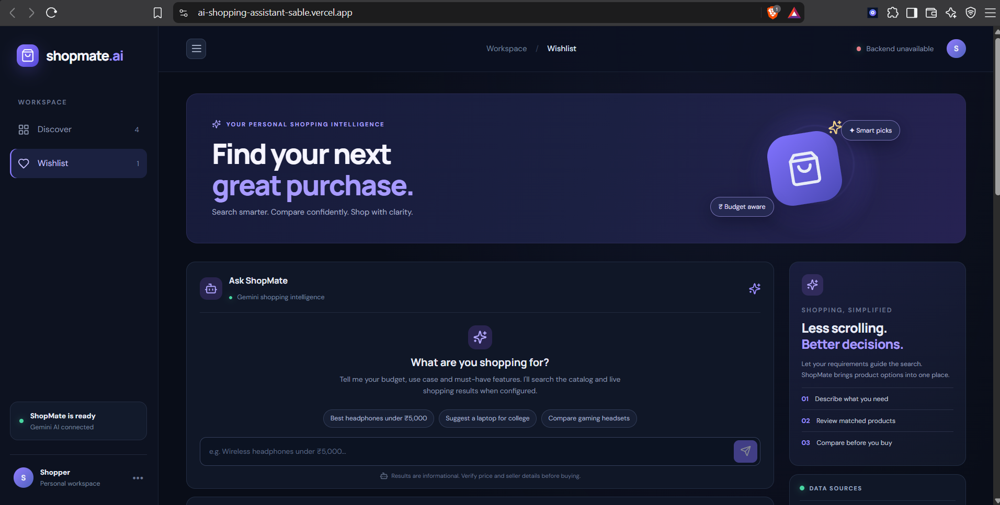
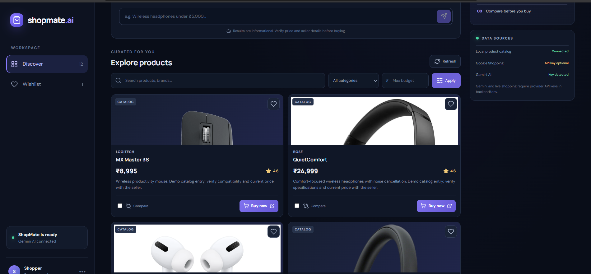
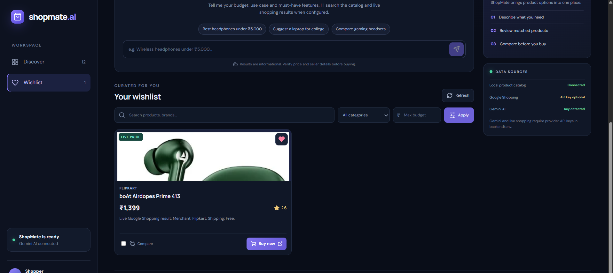
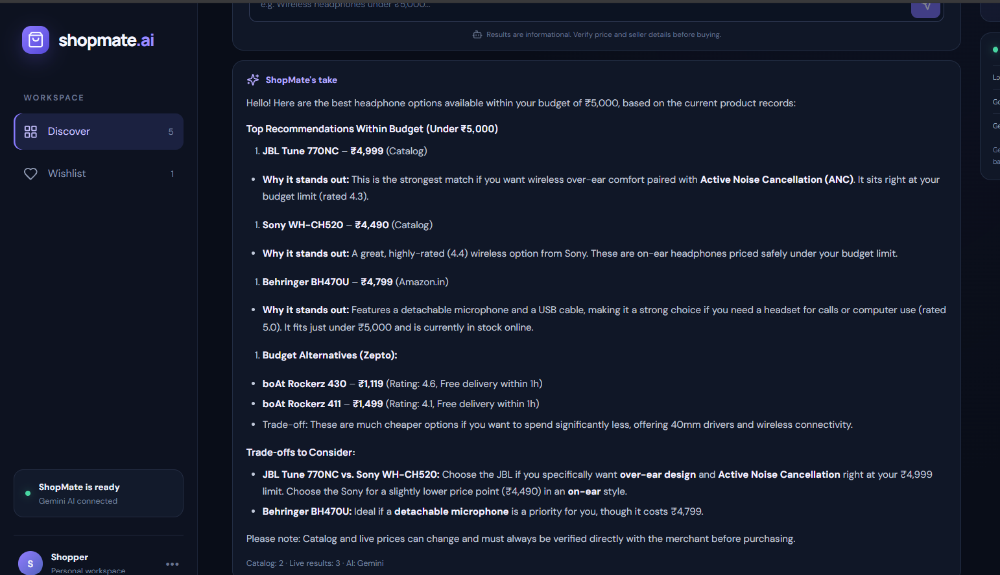
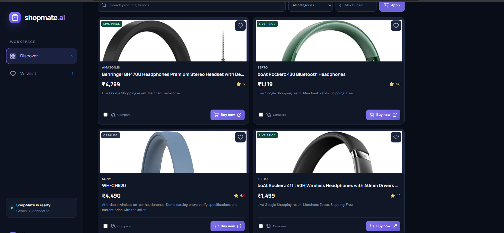

# 🛍️ ShopMate AI — Your Personal AI Shopping Assistant

**Shop smarter. Compare confidently. Buy with clarity.**

ShopMate AI is a full-stack AI-powered shopping assistant that helps users discover products, explore live shopping results, receive intelligent recommendations, and compare products before making a purchase.

Instead of switching between multiple shopping platforms, ShopMate brings product discovery and AI-assisted decision-making into one place.

<p align="center">
  <a href="https://ai-shopping-assistant-sable.vercel.app/"><strong>🚀 Live Demo</strong></a>
  &nbsp; | &nbsp;
  <a href="https://github.com/IshantDutta/AI-shopping-assistant"><strong>💻 GitHub Repository</strong></a>
</p>

---

## 🎬 Project Demo

[▶ Watch the ShopMate AI Demo](Assets/demo/shopmate_demo.mp4)

---

## 📸 Screenshots

### 1. Homepage and Dashboard


### 2. Product Discovery and Catalog


### 3. Wishlist


### 4. AI-Powered Recommendations


### 5. Live Shopping Results


---

## ✨ Features

- **AI Shopping Assistant:** Uses Google's Gemini AI to understand shopping requirements and generate contextual recommendations.
- **Live Product Search:** Retrieves shopping results through SerpApi and Google Shopping.
- **Product Discovery:** Browse a curated product catalog with images, prices, ratings, and descriptions.
- **Smart Product Comparison:** Compare selected products and identify the best-value option using comparison scoring.
- **Wishlist Management:** Save products for later and access them across page refreshes on the same browser.
- **Budget-Based Discovery:** Explore products based on budget and category filters.
- **Merchant Redirection:** Visit merchant pages directly through product purchase links.
- **Responsive Interface:** A modern dark-themed interface built with React.

---

## 🧠 How It Works

1. The user describes what they want to purchase, including budget and requirements.
2. The backend processes the request and retrieves relevant catalog and live shopping results.
3. Gemini AI generates recommendations based on the user's requirements and available product information.
4. Users explore product cards, save products, and select items for comparison.
5. The comparison engine evaluates the selected products and highlights the best-value option.
6. Users can proceed to the merchant website to verify the product and complete their purchase.

---

## 🛠️ Tech Stack

| Layer | Technologies |
|---|---|
| Frontend | React.js, Vite, CSS |
| Backend | Python, FastAPI |
| Database | SQLite, SQLAlchemy |
| AI Integration | Google Gemini API |
| Live Shopping Search | SerpApi, Google Shopping |
| API Validation | Pydantic |
| Version Control | Git, GitHub |
| Deployment | Vercel, Render |

---

## 🏗️ Project Architecture

```text
ShopMate-AI/
│
├── backend/
│   ├── routers/
│   │   ├── assistant.py
│   │   └── products.py
│   │
│   ├── services/
│   │   ├── ai_service.py
│   │   ├── comparison_service.py
│   │   ├── live_search_service.py
│   │   ├── product_service.py
│   │   └── recommendation_service.py
│   │
│   ├── database.py
│   ├── main.py
│   ├── models.py
│   ├── schemas.py
│   ├── seed.py
│   └── requirements.txt
│
├── frontend/
│   ├── src/
│   │   ├── components/
│   │   ├── services/
│   │   ├── App.jsx
│   │   ├── main.jsx
│   │   └── styles.css
│   ├── package.json
│   └── vite.config.js
│
├── data/
│   └── products.json
│
├── Assets/
│   ├── screenshots/
│   └── demo/
│
└── README.md
```

---

## ⚙️ Run Locally

### Prerequisites

- Python 3.10+
- Node.js and npm
- Git

### 1. Clone the repository

```bash
git clone https://github.com/IshantDutta/AI-shopping-assistant.git
cd AI-shopping-assistant
```

### 2. Backend setup

```bash
cd backend

python -m venv .venv
```

Activate the virtual environment:

**Windows PowerShell**
```powershell
.venv\Scripts\Activate.ps1
```

Install dependencies:

```bash
pip install -r requirements.txt
```

Create a `.env` file inside the `backend` directory:

```env
GEMINI_API_KEY=your_gemini_api_key
GEMINI_MODEL=your_configured_gemini_model

SERPAPI_API_KEY=your_serpapi_api_key
SERPAPI_COUNTRY=in
SERPAPI_LANGUAGE=en

CORS_ORIGINS=http://localhost:5173
```

Start the backend:

```bash
python -m uvicorn main:app --reload
```

Backend API:
`http://127.0.0.1:8000`

Interactive API documentation:
`http://127.0.0.1:8000/docs`

### 3. Frontend setup

Open a second terminal:

```bash
cd frontend
npm install
```

Create a `.env` file inside the `frontend` directory:

```env
VITE_API_BASE_URL=http://127.0.0.1:8000
```

Start the frontend:

```bash
npm run dev
```

Open:
`http://localhost:5173`

---

## 🔑 API Integrations

| Service | Purpose |
|---|---|
| Google Gemini | AI-powered shopping assistance and recommendations |
| SerpApi | Live Google Shopping search results |
| FastAPI | Backend API and request handling |

**Note:** Gemini and SerpApi features require valid API keys. The local product catalog can be used independently of live shopping search.

Never commit API keys or `.env` files to GitHub.

---

## 🌐 Deployment

ShopMate AI is deployed using:

- **Frontend:** Vercel
- **Backend:** Render

Live application:  
https://ai-shopping-assistant-sable.vercel.app/

The frontend communicates with the deployed FastAPI backend through the configured API base URL.

---

## 🔮 Future Improvements

- User authentication and individual shopping profiles.
- Cloud-based wishlist synchronization.
- Persistent database storage.
- More advanced recommendation ranking.
- Additional shopping platform integrations.

---

## 👨‍💻 Author

**Ishant Dutta**

Computer Science Engineering | AI & Data Science

- GitHub: [@IshantDutta](https://github.com/IshantDutta)
- Project: [ShopMate AI](https://github.com/IshantDutta/AI-shopping-assistant)
- Live Application: [ShopMate AI](https://ai-shopping-assistant-sable.vercel.app/)

---

<p align="center">
  <strong>ShopMate AI — Less scrolling. Better decisions.</strong>
</p>
